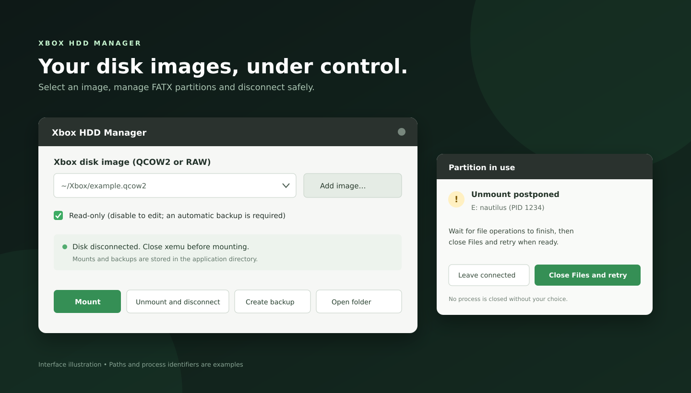

# Xbox HDD Manager

A Linux desktop utility for browsing and editing original Xbox FATX partitions in standalone QCOW2 and RAW disk images. Created by **AITUS95**.



*Interface illustration. Paths and process identifiers are examples.*

## Features

- Select and remember multiple disk images in a drop-down list.
- Mount the standard C, E, X, Y and Z FATX partitions using FUSE and a dynamically selected NBD device.
- Start in read-only mode. A verified, independent SHA-256 backup is required before a read/write mount.
- Unmount and disconnect safely, with recovery for interrupted sessions and checks for a changed NBD identity.
- Detect processes holding a partition open. For Nautilus, an optional action requests a normal quit after file operations have finished and then retries.
- Preserve backups and user data during uninstallation.

## Requirements

Linux with kernel NBD and FUSE support, Python 3 with GTK 3/PyGObject, Polkit (`pkexec`), QEMU utilities, FUSE 2, ACL tools, `fuser`, CMake, a C compiler and `pkg-config`. A desktop session is required. An administrator password may be requested when connecting or disconnecting an image.

On Ubuntu and Debian, install the dependencies from the distribution repositories:

```sh
sudo apt update
sudo apt install build-essential cmake pkg-config libfuse-dev fuse qemu-utils \
  python3 python3-gi gir1.2-gtk-3.0 acl psmisc pkexec kmod util-linux xdg-utils
```

Other Linux distributions can use the source archive and their equivalent packages. The installer has been designed for Linux systems with these tools, but distribution-specific packages have not been validated.

## Install

Download and extract a release archive, or clone this repository, then run:

```sh
bash install.sh
```

The default application directory is `~/.local/share/xbox-hdd-manager`. To select a different directory, set `XBOX_HDD_DIR` before running the installer. The installer builds the included FATX driver and adds an application-menu entry. It does not install system packages or overwrite an existing installation.

```sh
XBOX_HDD_DIR="$HOME/Applications/Xbox-HDD-Manager" bash install.sh
```

## Update an existing installation

Run the updater from a new source archive with the existing installation path:

```sh
bash update.sh --target "$HOME/Applications/Xbox-HDD-Manager"
```

Close the application and disconnect the image before updating. The updater builds a fresh FATX driver and preserves existing disk images, backup directories and image lists. Existing installations with different data-folder names can supply `--mounts-folder`, `--backups-folder` and `--image-list`; names must be single entries within the application directory.

## Use

1. Close xemu and any other program using the image.
2. Open **Xbox HDD Manager**, select **Add image…**, and select a standalone QCOW2 or RAW image.
3. Keep **Read-only** enabled for browsing. To edit, clear it and confirm the backup prompt.
4. Select **Mount**. Open the mounted partitions through **Open folder**.
5. Wait for all file operations to finish, close programs using the partitions, then select **Unmount and disconnect**. Do not start xemu until the disk has been disconnected.

If a partition is busy, the application identifies visible processes and leaves the disk connected. For Nautilus, the dialog can request that all Files windows close; use that option only after file operations have finished. No process is terminated automatically.

Backups are placed in `Backups` within the application directory and are not deleted automatically. Make sure sufficient space is available. Keep independent backups of important data; FATX support is provided by a third-party driver.

The application handles disk **image files**, not physical `/dev/sdX` devices. QCOW2 backing files, encrypted images, external data files, and expanded F/G partition layouts are not supported. Internal QCOW2 snapshots are included in file-level backups.

## Uninstall

Close the application and disconnect any image first. Run `uninstall.sh` from the installed application directory. Backups, logs and user data are preserved.

```sh
bash ~/.local/share/xbox-hdd-manager/uninstall.sh
```

## Development and verification

```sh
python3 -m unittest discover -s tests -v
```

`tests/test_image.sh PATH_TO_QCOW2` converts a provided image into disposable copies and exercises FATX reads, writes, renames, truncation, deletion and a QCOW2 round trip. It needs approximately 12 GiB of temporary space. `tests/test_mount.py` is a separate end-to-end FUSE/NBD test for a normal Linux host, with its own temporary image. Run it from the installed directory as `python3 tests/test_mount.py PATH_TO_QCOW2`. Never run the tests against an image being used by xemu.

## License and acknowledgments

The project is distributed under [GPL-2.0](LICENSE). The bundled FATX driver and library derive from [XboxDev/fatx](https://github.com/XboxDev/fatx), at the revision recorded in `driver-commit.txt`; their original copyright and license notices are retained. Local driver changes initialize filesystem state and add FUSE flush/fsync handling.
